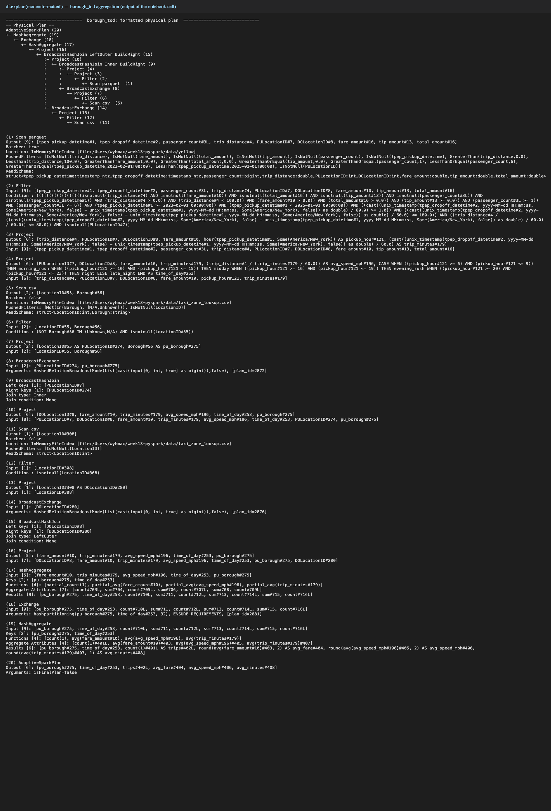
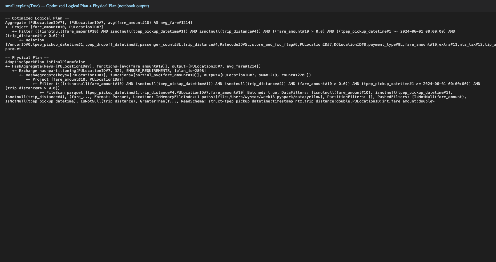
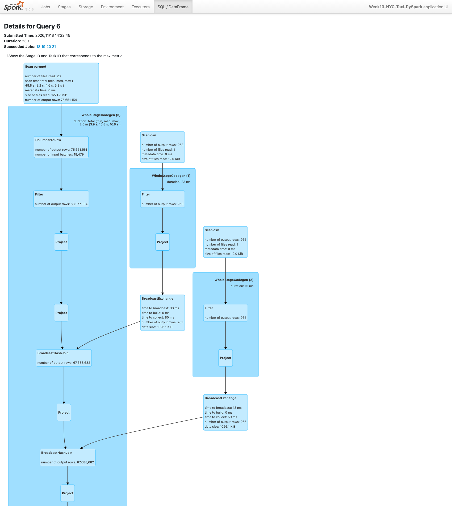
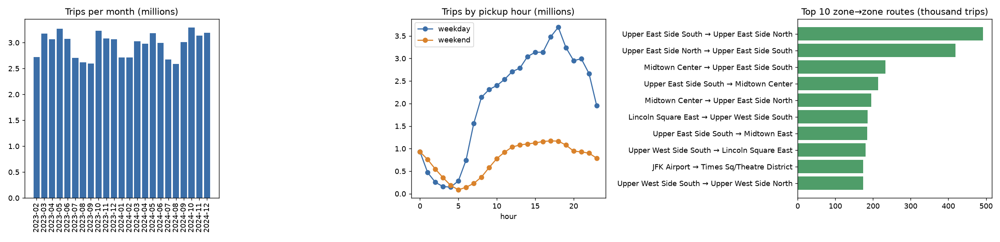

# Week 13 Mini Assignment — PySpark Data Processing (NYC Yellow Taxi, 76M rows)

A PySpark pipeline that cleans, enriches, aggregates, queries (DataFrame API **and** Spark SQL), optimises, writes and
models ~1.2 GB / **76.4 million** NYC yellow-taxi trips, with a measured performance analysis backed by `.explain()` output and
Spark UI "Query Details" screenshots.

| Deliverable | File |
|---|---|
| Pipeline notebook (executed, with all outputs) | [`pyspark_pipeline.ipynb`](pyspark_pipeline.ipynb) |
| HTML export of the executed notebook | [`pyspark_pipeline.html`](pyspark_pipeline.html) |
| Same pipeline as a plain Python script (percent format) | [`pipeline.py`](pipeline.py) |
| Screenshots | [`images/`](images) |
| Pipeline outputs (small aggregates, timings) | [`output/aggregates/`](output/aggregates), [`output/timings.csv`](output/timings.csv) |

> **Environment:** local mode, PySpark 3.5.3, Java 17, MacBook (8 cores, 8 GB RAM, driver heap 5 GB). The Spark UI screenshots come from the
> Spark **History Server** replaying the application's event log (the same SQL / DataFrame “Query Details” pages Databricks shows).

---

## 1. Dataset

| | |
|---|---|
| **Trips** | NYC Taxi & Limousine Commission *Yellow Taxi Trip Records*, 23 monthly Parquet files, **Feb 2023 – Dec 2024**, 1.28 GB on disk, **76,413,180 rows**, 19 columns. Source: <https://www.nyc.gov/site/tlc/about/tlc-trip-record-data.page> (files `https://d37ci6vzurychx.cloudfront.net/trip-data/yellow_tripdata_YYYY-MM.parquet`) |
| **Zones** | TLC *Taxi Zone Lookup* CSV, 265 zones → borough / zone name (used for the join). `https://d37ci6vzurychx.cloudfront.net/misc/taxi_zone_lookup.csv` |

2023-01 was deliberately excluded: its Parquet physical types (`int64`/`double`) differ from every later month (`int32`/`int64`), which would force a per-file schema merge.

**Reproduce:** download the files into `data/yellow/` and `data/taxi_zone_lookup.csv`, then `pip install pyspark==3.5.3 pandas matplotlib pyarrow requests setuptools jupyter` and run
`jupyter nbconvert --to notebook --execute pyspark_pipeline.ipynb` (≈ 15 min on a laptop). Raw data, the 2.3 GB `output/curated_trips/` table and the Spark event logs are git-ignored.

## 2. Pipeline overview (rubric mapping)

| Requirement | Where / what |
|---|---|
| **Load** Parquet with PySpark | §1 — `spark.read.parquet("data/yellow")` (23 files, 12 input partitions) + `spark.read.csv` for zones |
| **2+ filters** | §2 — **six** filters: distance (0,100), fare/total > 0 & tip ≥ 0, passengers 1-6, pickup date range (all on raw columns → pushed down) + trip duration 1-180 min and speed ≤ 80 mph (on derived columns) |
| **Join** | §2 — two **broadcast** left joins of the fact table with the 265-row zone table (pickup zone & dropoff zone) |
| **groupBy + aggregations** | §2b — monthly, borough × time-of-day, hour × weekend, top routes; plus a **window function** (`row_number` over aggregated zone counts → top-3 zones per borough) |
| **`withColumn`** | §2 — `pickup_hour`, `pickup_dow`, `is_weekend`, `year_month`, `trip_minutes`, `avg_speed_mph`, `fare_per_mile`, `tip_pct` (conditional), `time_of_day` (`when/otherwise` chain) |
| **2+ SQL queries** | §5 — **four** queries: CTE + `LAG` (month-over-month revenue), partition pruning + `RANK()` window (top zones), `HAVING` + `percentile_approx` (tipping), `CASE WHEN` (airport vs other) |
| **Optimisation** | column pruning, early filters, broadcast joins, partitioned output, AQE — each measured in §6 |
| **Write results** | §4 — `curated_trips/` (68.1 M rows, Parquet, `partitionBy("year_month")`, 23 partitions) and `aggregates/*` Parquet; read back & row-count verified |
| **`.explain()` + Spark UI** | §6a plus `images/` (below) |
| **Actions vs transformations** | §3 — measured job counts & timings |
| **Caching (bonus)** | §7 |
| **MLlib (optional)** | §8 — fare regression, R² = 0.94 |

### Cleaning result
76,413,180 raw rows → **68,077,034** clean trips (89.1 %) after the six filters.

---

## 3. Actions vs. transformations (§3 of the notebook)

Nine chained transformations (`filter → filter → withColumn → withColumn → select → join → groupBy.agg → orderBy`) on the 76 M-row table:

| step | wall time | Spark jobs launched |
|---|---|---|
| 9 transformations (build the plan) | **27 ms** | **0** |
| `lazy.explain()` | – | **0** (explain inspects the plan, it is not an action) |
| `lazy.collect()` (action) | **2,035 ms** | **5** |

Transformations only extend the logical plan (DAG) and return immediately; nothing is read. The **action** triggers Catalyst optimisation, stage creation and the actual Parquet scan, shuffle and aggregation. Because Spark sees the whole chain before running anything it can push filters down, prune columns and choose a broadcast join (see §4 below). Also note that **without `.cache()` every action re-executes the entire lineage** (§7).

---

## 4. Performance analysis

### 4.1 Execution plans (`.explain()`)

Formatted physical plan of the main `borough × time_of_day` aggregation (full text in the notebook, screenshot below):



Optimised logical + physical plan of a small query written *"badly"* on purpose (`select` first, filters afterwards, in the “wrong” order):



### 4.2 Spark UI screenshots

| What | Screenshot |
|---|---|
| **Successful pipeline execution** — Jobs tab: 155 completed jobs, 0 failed | [`01_jobs_all_succeeded.png`](images/01_jobs_all_succeeded.png) |
| SQL / DataFrame tab: every query of the run, labelled by pipeline step | [`02_sql_queries_list.png`](images/02_sql_queries_list.png) |
| **Query Details** — main aggregation: 1 Parquet scan, 2 `BroadcastHashJoin`s, no shuffle before the partial aggregate | [`03_query6_borough_agg_broadcast_join.png`](images/03_query6_borough_agg_broadcast_join.png) |
| Query Details — range filter (pushed down) | [`04_query19_pushdown_range_filter.png`](images/04_query19_pushdown_range_filter.png) |
| Query Details — same logic with `year()/month()` (not pushed down) | [`05_query17_no_pushdown_year_month.png`](images/05_query17_no_pushdown_year_month.png) |
| Query Details — broadcast hash join | [`06_query25_broadcast_hash_join.png`](images/06_query25_broadcast_hash_join.png) |
| Query Details — sort-merge join (broadcast disabled): 925 MiB shuffled, 640 MiB spilled | [`07_query24_sort_merge_join.png`](images/07_query24_sort_merge_join.png) |
| Query Details — partition pruning on the curated table (3 files read) | [`08_query26_partition_pruning.png`](images/08_query26_partition_pruning.png) |
| Query Details — write **with** `repartition("year_month")` (18.3 GiB shuffle) | [`09_query33_repartition_write_shuffle.png`](images/09_query33_repartition_write_shuffle.png) |
| Query Details — final write, `partitionBy` only (no shuffle) | [`10_query4_write_no_shuffle.png`](images/10_query4_write_no_shuffle.png) |
| Query Details — query on the cached DataFrame (`InMemoryTableScan`) | [`11_query40_cached_inmemory_scan.png`](images/11_query40_cached_inmemory_scan.png) |
| Stages tab (shuffle read/write, spill) | [`12_stages_shuffle_spill.png`](images/12_stages_shuffle_spill.png) |



### 4.3 Measured experiments (each changes one thing; fresh DataFrame per run; best of 2 where noted)

| Experiment | Baseline | Optimised | Evidence |
|---|---|---|---|
| **Filter pushdown / sargable predicate** (June 2024 trips) | `year(ts)==2024 & month(ts)==6`: **8.5 s** — `PushedFilters` has only `IsNotNull` | `ts >= '2024-06-01' & ts < '2024-07-01'`: **1.05 s** (8×) — `PushedFilters` contains `GreaterThanOrEqual/LessThan` | `explain`, UI Q17 vs Q19 |
| **Column pruning** | touching all 19 columns: **8.6 s**, scan time 21.3 s | only `fare_amount`: **0.41 s** (21×), scan time 1.4 s | `ReadSchema` struct with 19 fields vs 1 |
| **Join strategy** (2024, join with zones) | sort-merge join (broadcast disabled): **7.85 s**, 4 `Exchange`s, 925 MiB shuffled, 640 MiB spilled | broadcast hash join: **2.63 s** (3×), 2 `Exchange`s, 1 KiB broadcast | `explain`, UI Q24 vs Q25 |
| **Partition pruning** on the written table | `year()/month()` on data column: **3.2 s**, 68 files / 2.3 GiB / 23 partitions read | `year_month = '2024-06'`: **0.09 s** (35×), **3 files / 105 MiB / 1 partition** | `PartitionFilters: [year_month = 2024-06]`, UI Q26 vs Q28 |
| **Write strategy** (68 M rows → Parquet by month) | `repartition("year_month")` + `partitionBy`: **274 s**, 18.3 GiB shuffled, 23 files | `partitionBy` only: **197 s** (-28 %), **no shuffle**, 68 files | UI Q33 vs Q4 |
| Shuffle partitions (full-data `groupBy`) | 200 partitions, AQE off: 7.7 s | 32 partitions: 6.9 s; 32 + AQE: 7.9 s | no meaningful difference — the aggregate is tiny |

*(Numbers: single run on a laptop, so ±10–20 % noise is normal; the big ratios above are well outside that.)*

### 4.4 Analysis

**How Spark optimised the query.** Everything is lazy, so Catalyst sees the whole chain `select → filter ×4 → withColumn → filter ×2 → join → groupBy` as one logical plan and rewrites it. Filters written *after* the `select` (see the extended plan screenshot) are merged and moved directly above the `Relation`, and the Parquet scan only reads the columns that are actually used (`ReadSchema` lists 4 of 19 columns in the small query, 9 in the main pipeline) — column pruning is automatic, which is why the order in which I write `select`/`filter` makes no difference to the physical plan, but *what* I write does. The 265-row zone table is below `autoBroadcastJoinThreshold`, so both joins became `BroadcastHashJoin`: the 76 M-row fact table is never shuffled for the join (UI Query 6: two `BroadcastExchange` nodes of 1 MiB). Aggregations are executed as a map-side partial `HashAggregate`, one `Exchange hashpartitioning` of a few KiB, and a final `HashAggregate` — the only shuffle in the whole query. Adaptive Query Execution (AQE) is enabled and coalesces the 32 post-shuffle partitions at runtime.

**Where filters were pushed down.** All filters on raw columns that are plain comparisons (`trip_distance > 0 AND < 100`, `fare_amount > 0`, `total_amount > 0`, `tip_amount >= 0`, the pickup-date range, `IsNotNull(...)`) show up in the scan node's `PushedFilters` list, and are additionally kept as a `Filter` above the scan. The two filters on *derived* columns (`trip_minutes`, `avg_speed_mph`) cannot be pushed — they only exist after the `withColumn`s — which is why I placed them as late as possible and all pushable ones first. Wrapping a column in a function (`year(ts)`) makes the predicate non-pushable and 8× slower in my test. An honest caveat from the UI: the Scan node still reports 76.4 M output rows in both Q17 and Q19, because the taxi files are not sorted by time, so Parquet row-group min/max statistics cannot skip data inside a file; the 8× speed-up comes from cheap sargable comparisons vs. evaluating a date function on 76 M rows. **Partition pruning** on the written table is the case where filtering really avoids I/O: `PartitionFilters: [year_month = 2024-06]` reduced the scan from 68 files / 2.3 GiB to 3 files / 105 MiB (35× faster).

**Bottlenecks found and how I fixed them.** (1) My first version wrote the curated table with `repartition("year_month")` to get tidy files. The Stages tab showed that single stage as the dominant cost of the whole application: a **18.3 GiB / 7.4 GB-compressed shuffle with 15 GiB of spill** (the 23 monthly keys land in 32 skewed partitions) and 274 s. Because the input files are already monthly, each write task only holds 1–2 months, so `partitionBy` alone gives 68 reasonably-sized files without any shuffle: 28 % faster and no shuffle (UI Q4 vs Q33). Remaining cost there is the per-task sort by partition value (17 GiB spill, 5 GB heap). (2) The scan of 19 columns vs 1 and the function-wrapped filter were the next-biggest wasted work (21× and 8× above). (3) Disabling the broadcast turned a 2.6 s query into a 7.9 s one with 925 MiB of shuffle and spill, which is exactly what the broadcast join avoids. (4) Tuning `spark.sql.shuffle.partitions` was *not* a bottleneck here — the aggregated results are small, so 32 vs 200 partitions made no measurable difference (7–8 s each). The overall pipeline is scan-bound: reading and decoding the Parquet columns (≈ 42 s total scan time across 12 tasks for the write) dominates, so fewer columns and partition pruning are the levers that matter.

### 4.5 Bonus — `.cache()` (§7)

Five different actions (`count`, avg fare by borough, avg speed by hour, trips by month, max fare per zone) on the 68 M-row enriched table (raw → 6 filters → `withColumn`s → 2 joins; 8 columns kept). Without cache every action re-runs the whole lineage; with `.cache()` the first action materialises the data (2.3 GB in memory, 12/12 partitions, `Disk Memory Deserialized`), then the rest read it from `InMemoryTableScan`.

| action | no cache | `.cache()` |
|---|---|---|
| 1 `count()` | 14.9 s | 70.5 s *(includes one-off materialisation)* |
| 2 avg fare by borough | 18.7 s | **3.9 s** |
| 3 avg speed by hour | 21.2 s | **2.6 s** |
| 4 trips by month | 43.8 s | **2.1 s** |
| 5 max fare per pickup zone | 7.6 s | **4.5 s** |
| **total (5 actions)** | **106 s** | **84 s** |

Once cached, repeated actions are 1.7–21× faster (4.8×, 8×, 21×, 1.7× per action); the cache pays for itself after about four actions here (materialisation is expensive because a 2.3 GB cache has to be built inside a 5 GB heap). With a larger or more complex lineage — or many more repeated actions — the gap grows. (The un-cached runs also benefited from a warm OS file cache, so the real-world benefit on cold storage is larger.) Screenshot: [`11_query40_cached_inmemory_scan.png`](images/11_query40_cached_inmemory_scan.png).

---

## 5. SQL queries (§5)

Run against the curated Parquet table registered as view `trips`. E.g. month-over-month revenue (CTE + `LAG`), partition-pruned top-3 pickup zones per borough (`RANK() OVER (PARTITION BY …)`), tip behaviour (`HAVING`, `percentile_approx`) and airport vs other trips (`CASE WHEN`). Full SQL and results are in the notebook.

## 6. Optional — MLlib (§8)

`Pipeline(StringIndexer → OneHotEncoder → VectorAssembler → regressor)` predicting `fare_amount` on a 2 % sample of 2024 trips (567,873 train / 141,758 test):

| model | test RMSE | test R² |
|---|---|---|
| LinearRegression | $4.51 | 0.938 |
| RandomForest (30 trees, depth 8) | **$4.39** | **0.941** |

Feature importances (RF): `trip_distance` 0.50, `trip_minutes` 0.26; hour, weekday, passengers and weekend ≈ 0 — the metered fare is almost purely distance + time (the remainder of the importance is carried by the pickup/dropoff borough features, e.g. flat airport fares).

---

## 7. Key findings from the data



* **68.1 M clean trips**, **$1.97 B** total revenue (Feb 2023 – Dec 2024), **average fare $19.77**. Ridership is stable at ~2.5–3.3 M trips/month with a clear seasonal pattern: peaks in **March, May, October** (busiest month **Oct 2024: 3.29 M trips**) and troughs in **Jan–Feb and Jul–Aug**.
* **Rush-hour economy:** the busiest pickup hour is **18:00**; weekday volume climbs all day to a peak of 3.7 M trips at 18:00 (vs 0.15 M at 04:00), while weekends are flat (~1.1 M/hour from 14:00 to 19:00) with a much stronger after-midnight tail (0.9 M at midnight, 0.76 M at 01:00 vs 0.93/0.47 M on weekdays).
* **Manhattan dominates:** 35.8 M of the 2024 trips (≈ 89 %) start in Manhattan; the top route is **Upper East Side South → Upper East Side North (491 k trips)**; the top pickup zones are Midtown Center and the Upper East Side, and **JFK / LaGuardia** lead Queens.
* **Traffic is slow:** average speed is only **9.7–9.9 mph** at midday and in the evening rush, 12 mph in the morning rush and 15 mph late at night.
* **Airport premium:** an airport drop-off costs **$59.98** on average (13.7 miles, 39.5 min) vs **$18.73** for a normal trip (3.2 miles, 16 min) — 3.2× the fare for 4.3× the distance.
* **Tipping:** credit-card riders tip **~25 %** of the fare on average; the highest average tip is on **weekday evening-rush** trips (**27.4 %**), the lowest on weekday mornings. (Cash tips are not recorded, so `tip_pct` is computed for `payment_type = 1` only.)
* **Fares are predictable:** distance and duration explain ~94 % of the variance of the fare (R² 0.94).

## 8. Repository layout

```
├── README.md
├── pipeline.py                    # script version (percent format, runs as a notebook in VS Code / jupytext)
├── pyspark_pipeline.ipynb         # executed notebook
├── pyspark_pipeline.html          # HTML export of the executed notebook
├── images/                        # explain() renders, Spark UI Query Details screenshots, charts
└── output/
    ├── aggregates/                # monthly, borough_time_of_day, hourly, top_routes, top_zones_per_borough (Parquet)
    └── timings.csv                # every timed step
```
